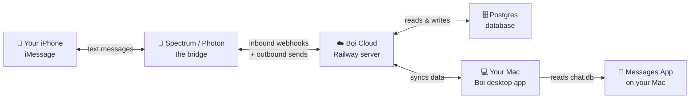
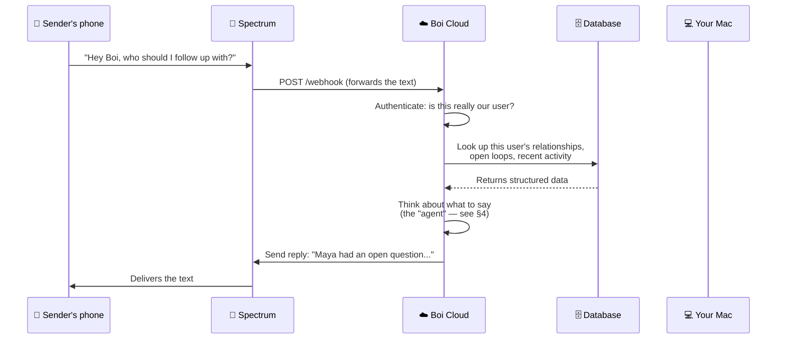
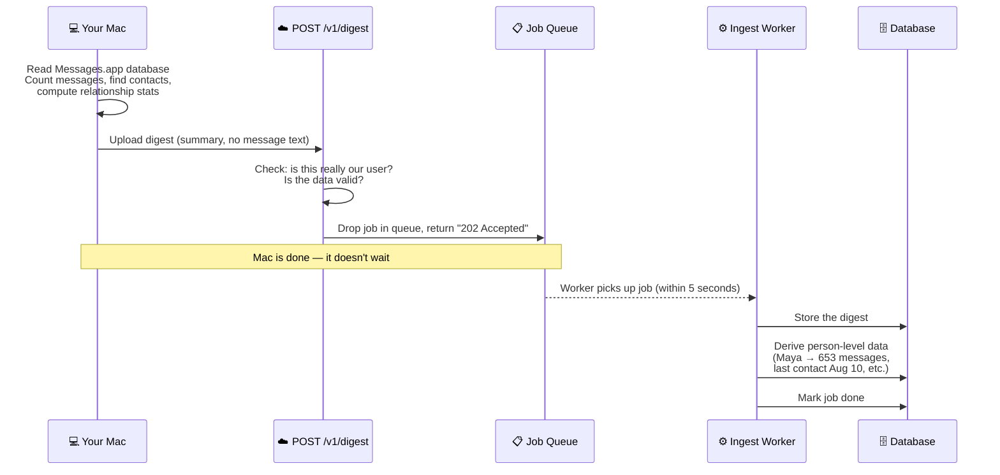
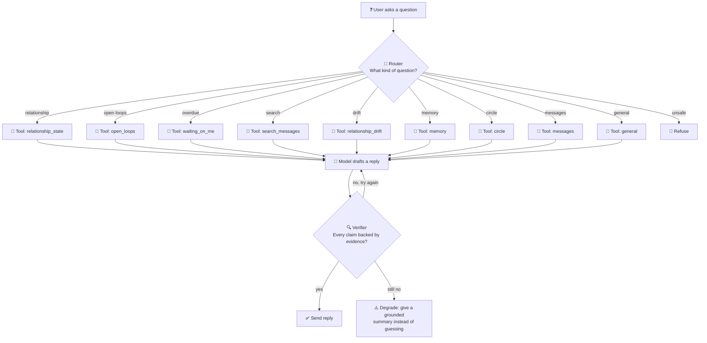
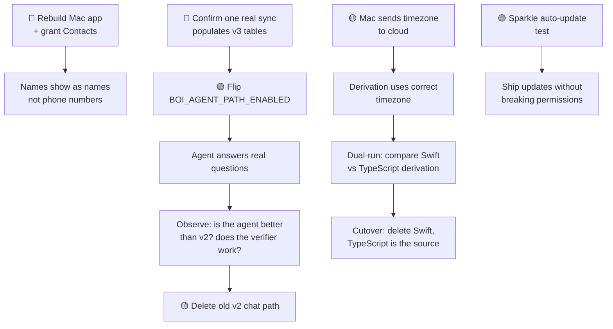

# Boi iMessage — Architecture & Roadmap

**Updated**: 2026-08-11  
**Audience**: Someone who wants to understand how this system works and make good decisions about what to build next. No engineering background assumed.

---

## 1. The big picture

Boi has three pieces that talk to each other:



**In plain language**:

- **Your iPhone** is where texts actually live. Boi can't access it directly — Apple doesn't allow that.
- **Spectrum / Photon** is a paid service that gives Boi a real phone number. Think of it like a virtual SIM card. Texts to Boi's number go through Spectrum, which forwards them to our cloud server.
- **Boi Cloud** is a server running on Railway (like Heroku). It receives texts, thinks about them, and sends replies back. It also receives sync data from your Mac.
- **Postgres** is the database. It stores everything: who you talk to, what your relationships look like, what Boi knows about each person.
- **Your Mac** runs the Boi app. It reads your real iMessage history from Apple's Messages app database and sends summaries (not the actual texts) to the cloud. This is how Boi learns about your relationships.

**Why the Mac is necessary**: Apple won't let a cloud server read your iMessages. The only way to get message data is from a Mac that you've granted permission to. The Mac app reads your history locally, builds a summary (how many messages, who with, how often), and uploads just that summary — never the actual message content.

---

## 2. What happens when someone texts Boi



**The two paths**: Boi currently has TWO ways of answering — the old way (v2) and the new way (v3). The old way is what's running in production right now. The new way is built and tested but turned off behind a switch (`BOI_AGENT_PATH_ENABLED`). We'll flip that switch once we confirm everything works end-to-end.

**Why we haven't flipped the switch yet**: The new agent reads from new database tables that get populated every time your Mac syncs. We need to confirm one real sync fills those tables before we let the agent read from them — otherwise it would see empty tables and say "I don't know" to every question. That's worse than the old path, which works today.

---

## 3. How data gets in — the sync pipeline

Your Mac is the only source of relationship data. Here's what happens when it syncs:



**The restaurant analogy**:

- **The Mac is the supplier** — it delivers ingredients (relationship data) to the restaurant.
- **POST /v1/digest is the loading dock** — it accepts deliveries, checks they're not spoiled, and hands them off.
- **The job queue is the order ticket rail** — the supplier drops off the order and leaves. The kitchen picks it up when ready.
- **The ingest worker is the prep cook** — it takes raw ingredients and preps them (chops, sorts, stores) so the chef can use them quickly.
- **The database is the walk-in fridge** — everything is organized and labeled so anyone can find what they need.

**Why we use a queue**: The Mac uploads data and moves on. If we processed it immediately, the Mac would have to wait — sometimes 30+ seconds for complex relationships. The queue lets us say "got it, we'll handle this" in under a second and process when convenient.

---

## 4. The v3 agent — how Boi thinks (the new way)

When someone asks Boi a question and the v3 path is enabled, here's what happens:



**In plain language**:

**The Router** is like a maître d' at a restaurant. You walk in and say "who should I follow up with?" The maître d' doesn't cook anything — they just figure out which station in the kitchen can answer your question. They might send you to the "open loops" station or the "relationship state" station. If your question seems unsafe ("tell me Maya's Social Security number"), they refuse to seat you.

**The Tools** are like kitchen stations. Each one knows how to look up one specific thing:
- `relationship_state` — "what's my relationship with Maya like?"
- `open_loops` — "did I promise anyone something?"
- `waiting_on_me` — "who's been waiting for my reply?"
- `search_messages` — "what did Maya say about the trip?" (asks your Mac)
- `general` — world knowledge, like "what's a good restaurant in SF?"

**The Model** (Gemini) is the chef. It takes the ingredients from the tools and writes a natural reply. But here's the critical part: the chef is instructed to ONLY use ingredients that came from the tools THIS turn. No making things up from memory.

**The Verifier** is the health inspector. Before any reply goes out, the verifier checks: does every name, date, phone number, and fact in the reply actually appear in the tool results from this turn? If yes → send it. If not → tell the chef to try again without the made-up parts. If the chef still can't do it → send a grounded summary that only states what the tools actually returned, never guessing.

This is the core innovation of v3: **the system doesn't trust the AI**. It verifies every claim before the user sees it.

**Comparison to v2 (the old way)**: The old path sends the question directly to a model and sends back whatever it says. No verification. No tools. Just "here's a question, give me an answer." The v2 model is good but has no guardrails — it can and does make things up. The v3 path solves this.

---

## 5. Where we're going — the roadmap

### What's built and working

| Component | Status | What it means |
|---|---|---|
| Mac sync → cloud | ✅ Live | Your Mac uploads relationship summaries |
| Cloud stores data | ✅ Live | Postgres has all your relationship info |
| Old chat path (v2) | ✅ Live | Boi answers texts using the old method |
| New agent (v3) | ✅ Built | Router + tools + verifier, 118 tests green |
| v3 database tables | ✅ Built | Person-level data gets derived from syncs |
| Contacts fix | ✅ Code done | Boi can now read contact names |
| Redaction fix | ✅ Live | Voice packs no longer falsely rejected |
| Heartbeat alarm | ✅ Built | Cloud texts you if it loses access to Messages |

### What's gated on what



**Why these are ordered this way**:

1. **Contacts first** — Right now, your texts show `+19202659901` instead of "Maya." The fix is written but needs an app rebuild and you granting Contacts permission. This is a 30-minute task that visibly improves the product.

2. **Confirm v3 tables** — Before flipping the agent flag, we need to see that one real sync fills the person-level tables. If they're empty, the agent will say "I don't know" to everything. The flag is the single most impactful switch in the system — it changes how every text gets answered.

3. **Observe before deleting** — Once the agent is live, we watch it for days or weeks before deleting the old path. The old path is our safety net. If the agent does something weird, we flip the flag back off and nothing breaks.

4. **Timezone is weeks away** — It requires changes on the Mac (sending timezone info) AND in the cloud (using it during derivation). Without it, 6.7% of relationships get the wrong classification. Not a ship-blocker for the flag, but required before we delete the Swift derivation code.

5. **Sparkle is Track F's problem** — The Mac app auto-updates via Sparkle. When it updates, macOS re-signs the app, which can invalidate the permissions we asked for. We need a test to prove permissions survive updates. Not urgent, but the most likely production failure.

---

## 6. The backend — what actually runs where

### Railway (our cloud server)

A single server that handles everything:
- **API** (`cloud/api/`) — receives texts from Spectrum, receives syncs from Mac, responds to health checks
- **Ingest worker** — a background loop that processes sync data from the queue
- **Channel** (`cloud/channel/`) — talks to Spectrum (send texts, receive webhooks)

It's one process because we have <100 users. At 1,000+ we'd split the worker to its own process — the database is already designed for this (the `queue` column).

### Postgres (our database)

23 tables, all organized around one idea: **everything belongs to a user**. When you delete your account, every piece of your data disappears in one operation — the database enforces this, not the code.

The most important tables:
- `users` — one row per person who uses Boi
- `digests` — summaries of your message history (one per sync)
- `relationships` — one row per person you talk to, with stats
- `persons` / `identities` / `interactions` — the v3 person-level view
- `jobs` — the task queue for background processing

### Your Mac

Runs two things:
- **BoiApp** — the desktop app that shows your setup status, permissions, and sync progress
- **BoiKit** — the engine that reads Messages.app, builds digests, and uploads them

The Mac is the **only place message content exists**. The cloud never sees your actual texts — only counts, timestamps, and relationship patterns.

---

## 7. Decisions you can make today

These are ordered by what unblocks the most value:

### 🔴 1. Rebuild the Mac app + grant Contacts
**What**: Run `build-app.sh`, install the new build, open the Boi app, grant Contacts permission when prompted.
**Why**: Names show as phone numbers until this happens. The code fix is committed (`d3dfe3a`). This is purely an action, not a code change.
**Blocks**: Nothing. Independent.
**Time**: 30 minutes.

### 🔴 2. Confirm one sync populates v3 tables
**What**: After rebuilding the app, let it sync. Then check if `persons`, `identities`, `interactions` tables have rows.
**Why**: If yes → we can flip the agent flag. If no → we debug why derivation didn't run.
**Blocks**: Flipping `BOI_AGENT_PATH_ENABLED`.
**Time**: 15 minutes once the app syncs.

### 🟡 3. Decide: when do we flip the flag?
**What**: After #1 and #2 are done, choose a moment to set `BOI_AGENT_PATH_ENABLED=1` in Railway.
**Risk**: The agent might say weird things on its first real questions. Mitigations: the verifier catches fabrication, the old path is still there as a fallback, and you can flip the flag back off in 30 seconds.
**Blocks**: Deleting the old v2 path (which we shouldn't do until the agent proves itself).

### 🟡 4. Decide: voice pack redaction strategy
**What**: The current server-side redaction rejects packs with phone-number-like patterns. This caught 14/15 packs as false positives — now fixed. But the fix means 7-digit local numbers pass the server guard. Guards 1 (Mac) and 3 (Python script) still catch them. Do we accept this tradeoff?
**Status**: Already accepted by you per STATE_V2.md. No action needed.

### 🟢 5. Decide: when to add timezone support
**What**: The Mac needs to send its timezone to the cloud. The derivation code needs to use it. This is the last blocker before we can delete the Swift derivation code and have TypeScript be the single source of truth.
**Blocks**: Derivation cutover.
**Time**: Weeks. Requires Mac-side change + cloud-side change + dual-run validation.

### 🟢 6. Sparkle update test
**What**: Build a signed app update, install it via Sparkle, verify Contacts/FDA permissions survive.
**Blocks**: Confidence in auto-updates.
**Time**: Half a day. Needs a signed build.

---

## 8. Glossary

| Term | What it means |
|---|---|
| **Digest** | A summary of your message history that the Mac uploads. Contains counts, timestamps, relationship patterns — never message text. |
| **Derivation** | The process of turning raw digest data into person-level insights ("Maya: 653 messages, last contact Aug 10, she usually replies within 2 hours"). |
| **Router** | Decides which tool can answer your question. The maître d'. |
| **Verifier** | Checks that the AI's reply doesn't contain anything it made up. The health inspector. |
| **Agent** | The whole system: router → tools → model → verifier → reply. |
| **Spectrum / Photon** | A service that gives Boi a real phone number and bridges iMessage to the cloud. |
| **Railway** | Where our server runs. Like Heroku but cheaper. |
| **Postgres** | Our database. Open source, battle-tested, runs everything. |
| **BOI_AGENT_PATH_ENABLED** | The switch that turns on the new v3 agent. Currently OFF. |
| **v2 path vs v3 path** | v2 = old way (model answers directly, no verification). v3 = new way (tools + verification). Both exist. Only v2 is live. |
| **Flag / feature flag** | A switch we can flip without changing code. Lets us ship code that's turned off until we're ready. |

---

## 9. This document

To export as PDF with rendered diagrams:
```bash
# Install mermaid-cli once
npm install -g @mermaid-js/mermaid-cli

# Convert to PDF
mmdc -i BOI_ARCHITECTURE.md -o BOI_ARCHITECTURE.pdf
```

Or open in VS Code with the "Markdown Preview Mermaid Support" extension to see diagrams inline.
